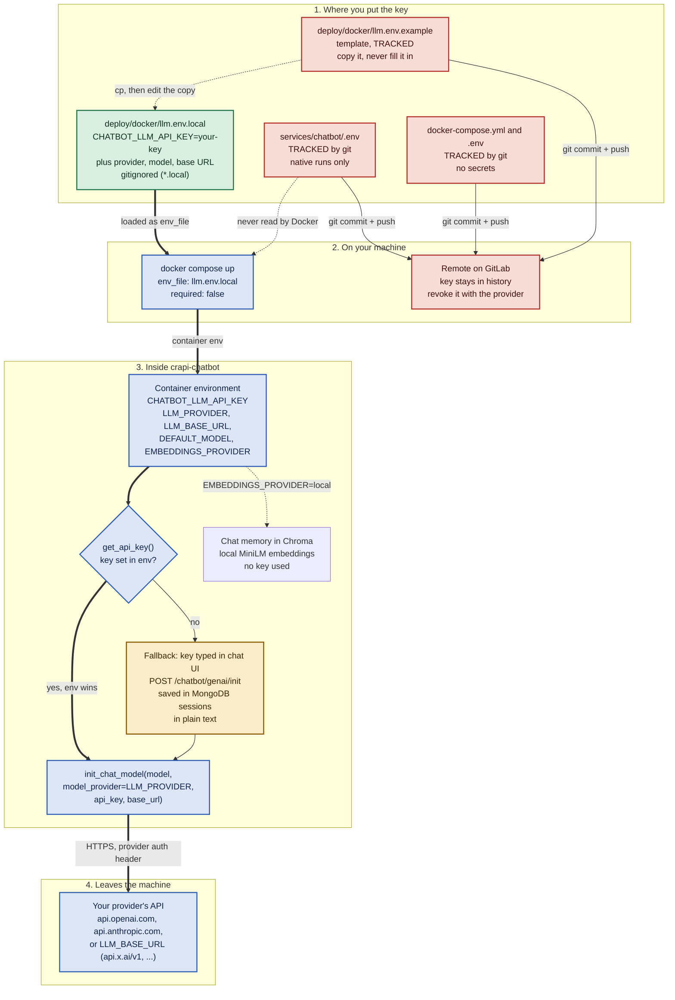

# Chatbot API Key Flow

How the `crapi-chatbot` LLM key gets from you to the provider, and what keeps it out of git. The flow is the same for every provider: OpenAI, Anthropic, xAI, or any OpenAI-compatible API. For the setup steps, see [Chatbot LLM Setup](../README.md#chatbot-llm-setup) in the README.

## Contents

- [The flowchart](#the-flowchart)
- [Stage by stage](#stage-by-stage)
  - [1. Where you put the key](#1-where-you-put-the-key)
  - [2. Docker Compose hands it to the container](#2-docker-compose-hands-it-to-the-container)
  - [3. The chatbot picks a key and a provider](#3-the-chatbot-picks-a-key-and-a-provider)
  - [4. The key leaves the machine](#4-the-key-leaves-the-machine)
- [What keeps the key hidden](#what-keeps-the-key-hidden)
- [Where the key can still be seen](#where-the-key-can-still-be-seen)
- [Files and code involved](#files-and-code-involved)

## The flowchart

Green boxes are gitignored. Red boxes are tracked by git, so a key put there leaks on the next push. The amber box is a fallback that stores the key in plain text. Thick arrows show the path the key takes when set up as the README describes.



## Stage by stage

### 1. Where you put the key

| Location | Tracked by git? | Read by Docker? | Verdict |
| --- | --- | --- | --- |
| `deploy/docker/llm.env.local` | No, matched by `*.local` | Yes, as the chatbot's `env_file` | The one place for the key |
| `deploy/docker/llm.env.example` | **Yes** | No | Template only. Copy it, never fill it in |
| `deploy/docker/docker-compose.yml`, `deploy/docker/.env` | **Yes** | Yes | No secrets. Never put a key here |
| `services/chatbot/.env` | **Yes**. Its `.gitignore` entry has no effect on a file git already tracks | No. Only a native run of the chatbot uses it | Never put a key here |

The key variable is `CHATBOT_LLM_API_KEY` for every provider. Upstream's `CHATBOT_OPENAI_API_KEY`, exported in your shell, works as a fallback. The chatbot reads no provider-specific names such as `XAI_API_KEY` or `ANTHROPIC_API_KEY`.

### 2. Docker Compose hands it to the container

The `crapi-chatbot` service in `docker-compose.yml` declares:

```yaml
    env_file:
      - path: ./llm.env.local
        required: false
```

`docker compose up`, run from `deploy/docker` directly or through `quickstart.sh`, reads every `NAME=value` line of `llm.env.local` into the container's environment. `required: false` means a fresh clone without the file still starts: the chatbot then runs on its code defaults (OpenAI, `gpt-4o-mini`, no key). This needs Docker Compose 2.24 or later.

The key is passed in when the container starts. The image never contains it, because the `Dockerfile` has no `ARG` or `ENV` for it. A changed value reaches the container only when it is recreated with `docker compose up -d`. `restart` keeps the old values.

### 3. The chatbot picks a key and a provider

`Config.LLM_API_KEY` in `services/chatbot/src/chatbot/config.py` reads `CHATBOT_LLM_API_KEY`, then `CHATBOT_OPENAI_API_KEY`. `get_api_key()` in `session_service.py` uses that first:

- **Key set in env:** the chatbot uses it. `/chatbot/genai/init` replies `Model Already Initialized` without storing anything.
- **No key in env:** the chatbot falls back to a key a user typed into the chat UI. `POST /chatbot/genai/init` saves it in the MongoDB `sessions` collection, in plain text. The UI's prompt says "OpenAI API key", but the key goes to whichever provider is configured.

`build_llm()` in `langgraph_agent.py` calls LangChain's `init_chat_model()` with `LLM_PROVIDER`, the model, the key and, if set, `LLM_BASE_URL`. `openai` gives a `ChatOpenAI` client (OpenAI or any OpenAI-compatible endpoint), and `anthropic` gives `ChatAnthropic`. The SQL toolkit reuses the same LLM object.

Chat memory in Chroma uses the key only when `EMBEDDINGS_PROVIDER=openai`. That is the default only for plain OpenAI, meaning `LLM_PROVIDER=openai` and no base URL. Every other setup defaults to `local`, the `all-MiniLM-L6-v2` model built into the image.

### 4. The key leaves the machine

The key leaves only in the provider's auth header over HTTPS: `Authorization: Bearer` for OpenAI-compatible APIs, `x-api-key` for Anthropic. It goes to the provider's default endpoint, or to `LLM_BASE_URL` when that's set. With a non-OpenAI provider and local embeddings, nothing is sent to `api.openai.com`.

## What keeps the key hidden

- The key lives only in `llm.env.local`, which `*.local` in `.gitignore` keeps out of every commit. `quickstart.sh` and the README tell you to `chmod 600` it.
- The tracked compose file, `.env` and template contain no secrets, so a fresh clone works without one.
- The key is set when the container starts, not built into the image, so `docker save` or pushing the image doesn't carry it.
- `crapi-chatbot` publishes no port. The only route in is `crapi-web`'s `/chatbot/` proxy, and no endpoint returns the key.
- When the key is set in the environment, it never gets written to MongoDB.
- Debug logs print only the first 5 characters (`chat_api.py`, `/init` and `/state`).

## Where the key can still be seen

- `docker inspect crapi-chatbot` and plain `docker compose config` print it in full. Use `docker compose config --quiet` to validate.
- An `export CHATBOT_OPENAI_API_KEY=...` typed straight into zsh is saved in `~/.zsh_history`. Use `llm.env.local` or `read -s`.
- Any process in the container can read its environment. The admin-level chatbot agent is a deliberate prompt-injection target in this lab, so use a key with a spending limit that you're willing to revoke.
- Any tracked file, the moment a key is typed into it: `llm.env.example`, `docker-compose.yml`, `deploy/docker/.env`, `services/chatbot/.env`.

## Files and code involved

| File | Role |
| --- | --- |
| `deploy/docker/llm.env.local` | Your provider, model, base URL and key. Gitignored |
| `deploy/docker/llm.env.example` | Tracked template for `llm.env.local` |
| `deploy/docker/docker-compose.yml` | Loads `llm.env.local` into `crapi-chatbot` via `env_file` (optional). Tracked, no secrets |
| `.gitignore` | `*.local` keeps `llm.env.local` out of git |
| `quickstart.sh` | Reports whether `llm.env.local` exists before deploying |
| `services/chatbot/src/chatbot/config.py` | Reads `LLM_PROVIDER`, `LLM_BASE_URL`, `DEFAULT_MODEL`, `EMBEDDINGS_PROVIDER` and the key, and picks the embeddings default |
| `services/chatbot/src/chatbot/session_service.py` | `get_api_key()`: env key first, then MongoDB |
| `services/chatbot/src/chatbot/chat_api.py` | `/genai/init` stores a UI-supplied key only when no env key is set |
| `services/chatbot/src/chatbot/langgraph_agent.py` | `build_llm()`: provider-specific chat client via `init_chat_model()` |
| `services/chatbot/src/chatbot/retriever_utils.py` | Local or OpenAI embeddings for chat memory |
| `services/chatbot/requirements.txt` | `langchain-openai` and `langchain-anthropic`; add other `langchain-*` packages for more native providers |
| `services/chatbot/Dockerfile` | Bakes in the local embedding model, no key |
