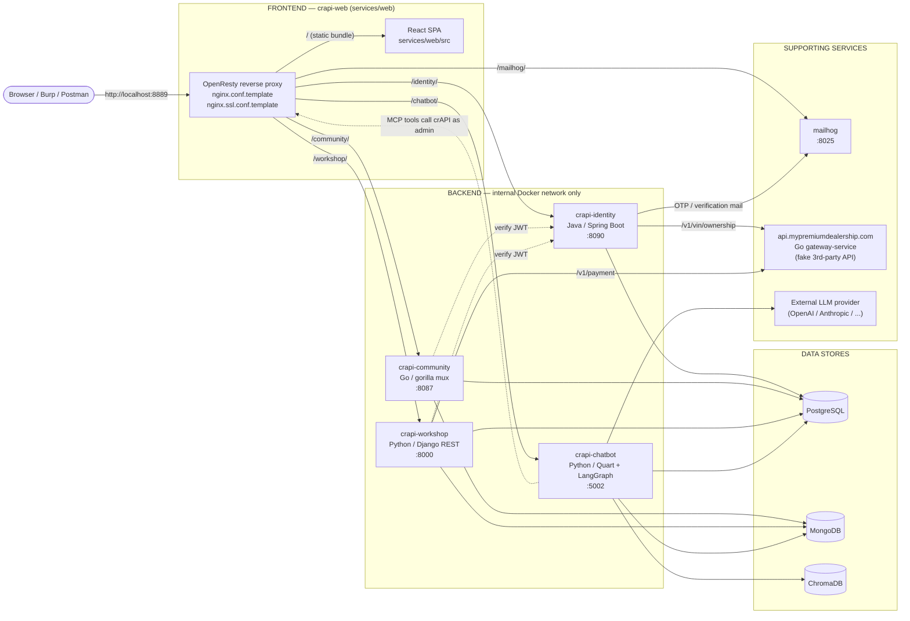
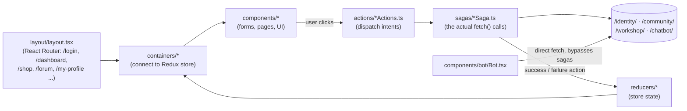
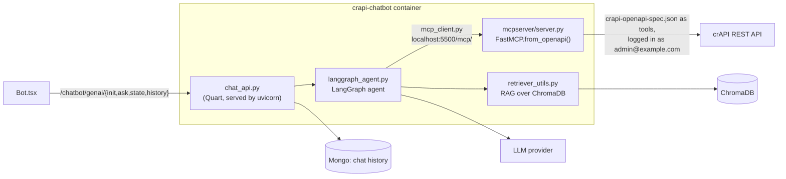
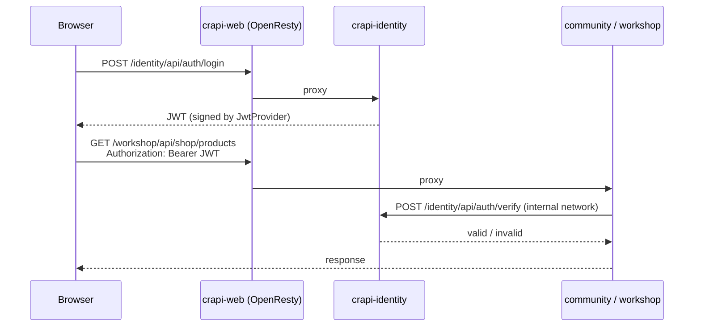

# crAPI Architecture — One Level Deeper

This expands on [crAPI_architecture.md](crAPI_architecture.md). It splits the codebase into frontend and backend and points to where the main work happens in each service. It is a map, not a full reference.

Ports below are this fork's defaults (`deploy/docker/.env` and `docker-compose.yml`). Upstream publishes the web UI on 8888; this fork uses **8889**.

---

## 1. The big picture



**The single entry point is `crapi-web`.** It serves the React bundle and reverse-proxies every API path to a backend container. Only `crapi-web` (8889 / 8443), `crapi-identity` (8090), and `mailhog` (8025) are published to the host; everything else is reachable only from inside the Docker network.

---

## 2. Frontend — `services/web`

The `crapi-web` container does two jobs, and they live in different files.

### 2a. The React SPA (what the user sees)

React 18 + TypeScript + Redux + Redux-Saga, built with webpack.



| Path | What it holds |
|---|---|
| `src/index.tsx` | App bootstrap, Redux store + saga middleware |
| `src/components/layout/layout.tsx` | All client-side routes |
| `src/containers/` | Redux-connected wrappers for each page |
| `src/components/` | UI: `login`, `signup`, `dashboard`, `shop`, `forum`, `profile`, `mechanicDashboard`, `bot`, ... |
| `src/actions/` | Action creators per domain: `user`, `vehicle`, `mechanic`, `shop`, `community`, `profile` |
| **`src/sagas/`** | **Every backend call the UI makes.** Read these to learn the real API surface. |
| `src/constants/APIConstant.ts` | Base URLs for each backend service |
| `src/config.ts.template` | Rendered at container start with the service URLs |
| `src/components/bot/Bot.tsx` | Chatbot widget. It calls `/chatbot/genai/*` directly rather than through a saga. |

### 2b. The OpenResty reverse proxy (the API gateway)

`services/web/nginx.conf.template` (HTTP) and `nginx.ssl.conf.template` (HTTPS) are rendered by `nginx-wrapper.sh` at container start. **They define the public API surface.** A new backend route has to be added to both.

| Location | Proxied to |
|---|---|
| `/identity/` | `crapi-identity` |
| `/community/` | `crapi-community` |
| `/workshop/` | `crapi-workshop` |
| `/chatbot/` | `crapi-chatbot` |
| `/.well-known/jwks.json` | `crapi-identity` → `/identity/api/auth/jwks.json` |
| `/mailhog/` | `mailhog:8025` |
| `/`, `/static`, `/images` | The built React bundle |

---

## 3. Backend — `services/*`

### At a glance

| Service | Stack | Owns | Entry point | Routes defined in | Business logic in | Data |
|---|---|---|---|---|---|---|
| **identity** | Java 17, Spring Boot 3 | Users, login/JWT, OTP, profile, vehicles | `identity/src/main/java/com/crapi/CRAPIBootApplication.java` | `controller/*Controller.java` | `service/Impl/*ServiceImpl.java` | Postgres (JPA) |
| **community** | Go, gorilla/mux | Forum posts, comments, coupons | `community/main.go` → `api/server.go` | `api/router/` | `api/controllers/`, `api/models/` | Postgres + Mongo |
| **workshop** | Python, Django REST | Mechanics, service requests, shop, orders | `workshop/manage.py`, `crapi_site/settings.py` | `crapi/urls.py` → `crapi/*/urls.py` | `crapi/*/views.py` | Postgres + Mongo |
| **chatbot** | Python, Quart + LangGraph + FastMCP | LLM assistant with crAPI tools | `chatbot/entrypoint.sh` (two processes) | `src/chatbot/chat_api.py` | `src/chatbot/langgraph_agent.py` | Postgres, Mongo, Chroma |
| **gateway-service** | Go, net/http (TLS) | Fake third-party dealership API | `gateway-service/main.go` | `main.go` | `main.go` | None. Deterministic fake data. |
| **mailhog** | Stock MailHog image | Catches all outgoing mail | — | — | — | In memory |

### 3a. Identity — `services/identity` (Java)

The only service that **issues** JWTs. The other services ask it whether a token is valid.

```
com/crapi/
├── CRAPIBootApplication.java      Spring Boot main
├── config/                        Security wiring
│   ├── WebSecurityConfig.java     which routes need auth
│   ├── JwtProvider.java           sign / parse / validate JWTs
│   ├── JwtAuthTokenFilter.java    pulls the Bearer token off each request
│   ├── InitialDataConfig.java     seeds default users and vehicles
│   └── MailHogConfiguration.java  SMTP → mailhog
├── controller/                    HTTP layer
│   ├── AuthController.java        /identity/api/auth/*  signup, login, verify, OTP, reset, jwks
│   ├── UserController.java        /identity/api/v2/user/*  dashboard, email/phone change
│   ├── ProfileController.java     profile pictures and videos
│   ├── VehicleController.java     add vehicle, vehicle location
│   └── ManagementControlller.java admin helpers (lock user, reset test users)
├── service/Impl/                  where the logic lives
│   ├── UserServiceImpl.java          login, token handling
│   ├── OtpServiceImpl.java           OTP generate / check
│   ├── ProfileServiceImpl.java       uploads, video convert (BashCommand)
│   ├── VehicleServiceImpl.java       vehicles and their GPS location
│   └── VehicleOwnershipServiceImpl.java  calls the premium dealership API
├── entity/  repository/           JPA tables and DAOs
└── utils/                         OTPGenerator, BashCommand, SMTPMailServer, ...
```

### 3b. Community — `services/community` (Go)

```
community/
├── main.go               starts the server
└── api/
    ├── server.go         connects to Postgres + Mongo, waits for identity
    ├── router/           every route → middleware → controller
    ├── middlewares/      JSON + authentication wrappers
    ├── auth/token.go     POSTs the token to identity /api/auth/verify
    ├── controllers/      post_controller.go, coupon_controller.go, home_controller.go
    ├── models/           post, comments, coupon (Mongo), user (Postgres)
    └── seed/             seed posts and coupons
```

Routes: `/community/api/v2/community/posts[/recent|/{id}|/{id}/comment|/{id}/like|/{id}/dislike]`, `/community/api/v2/coupon/{new-coupon,validate-coupon}`.

### 3c. Workshop — `services/workshop` (Django)

```
workshop/
├── crapi_site/settings.py   DBs (Postgres default + "mongodb"), identity URLs, gateway URL
├── utils/jwt.py             asks identity to verify the token on each request
└── crapi/
    ├── urls.py              /workshop/api/{mechanic,merchant,shop,management}/
    ├── mechanic/views.py    mechanic signup, service requests, reports
    ├── merchant/views.py    contact_mechanic: fetches a caller-supplied URL (the SSRF challenge)
    ├── shop/views.py        products, orders, returns, apply_coupon, payment via premium API
    └── user/views.py        admin user listing
```

Coupons are created in **community** but read by **workshop** directly from Mongo (`Coupon.objects.using("mongodb")`), so the two services share that data.

### 3d. Chatbot — `services/chatbot` (two processes in one container)



The agent runs every tool **as admin, whoever is chatting**. That is the design behind the LLM challenges (prompt injection, credential extraction, action hijacking).

### 3e. Supporting services

- **`gateway-service`**: a TLS-only Go server posing as `api.mypremiumdealership.com`. It has `/v1/vin/ownership` (called by identity) and `/v1/payment` (called by workshop) and returns fake PII seeded from the input.
- **`mailhog`**: traps every `@example.com` email. Signup verification, OTPs, and password resets are read at `http://localhost:8025`.

---

## 4. How a request is authenticated



Community and workshop never check the signature themselves. Changing token handling in identity therefore changes behavior everywhere at runtime.

---

## 5. Data stores

| Store | Used by | What's in it |
|---|---|---|
| **PostgreSQL** | identity, community, workshop, chatbot | Users, vehicles, OTPs, profiles (identity); mechanics, orders, products, applied coupons (workshop) |
| **MongoDB** | community, workshop, chatbot | Posts, comments, coupons (community, also read by workshop); chat sessions and history (chatbot) |
| **ChromaDB** | chatbot | Embeddings for the chatbot's retrieval (RAG) |

---

## 6. Where to look for ...

| If you're poking at ... | Start in |
|---|---|
| Login, signup, JWT, OTP | `identity/.../controller/AuthController.java`, `config/JwtProvider.java`, `service/Impl/OtpServiceImpl.java` |
| Vehicle location, IDs | `identity/.../controller/VehicleController.java`, `service/Impl/VehicleServiceImpl.java` |
| Profile picture and video upload | `identity/.../controller/ProfileController.java`, `service/Impl/ProfileServiceImpl.java` |
| Forum posts and comments | `community/api/controllers/post_controller.go` |
| Coupons | `community/api/controllers/coupon_controller.go`, `workshop/crapi/shop/views.py` (`ApplyCouponView`) |
| Shop, orders, refunds | `workshop/crapi/shop/views.py` |
| Contact mechanic (SSRF) | `workshop/crapi/merchant/views.py` |
| Mechanic reports | `workshop/crapi/mechanic/views.py` |
| Chatbot behavior and tools | `chatbot/src/chatbot/langgraph_agent.py`, `chatbot/src/mcpserver/server.py` |
| Which endpoints the UI hits | `web/src/sagas/` |
| Which paths are public | `web/nginx.conf.template` |
| Container wiring and env vars | `deploy/docker/docker-compose.yml` |
